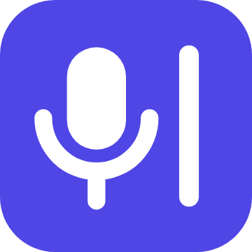
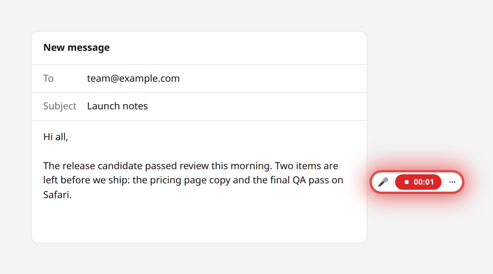
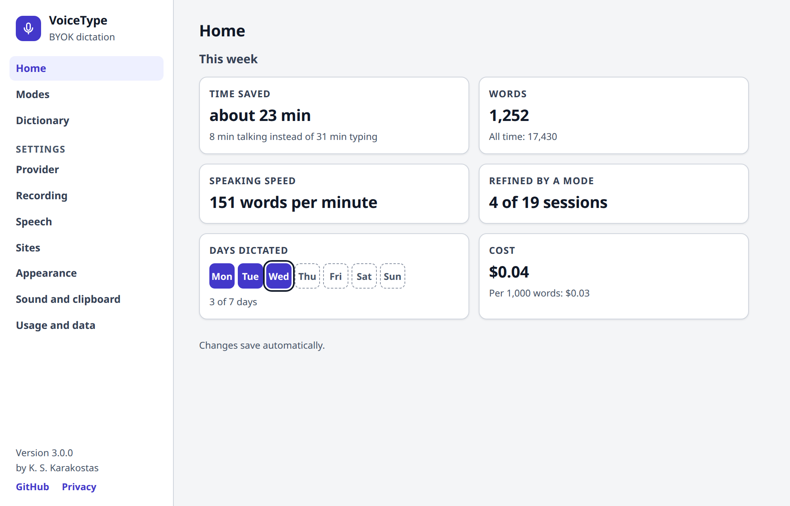
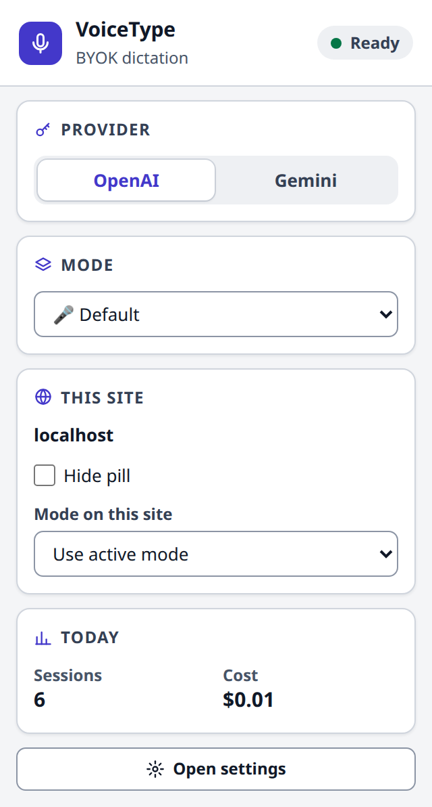
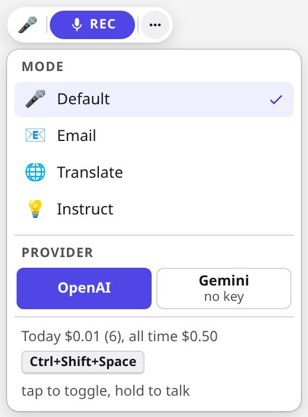
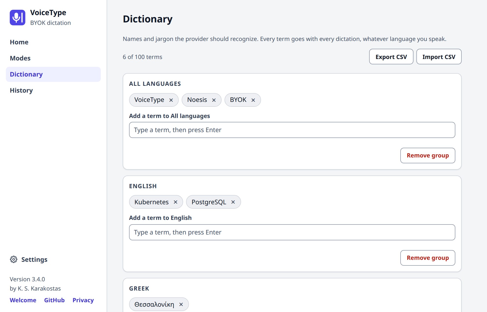
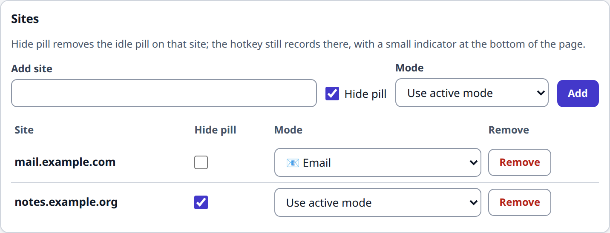
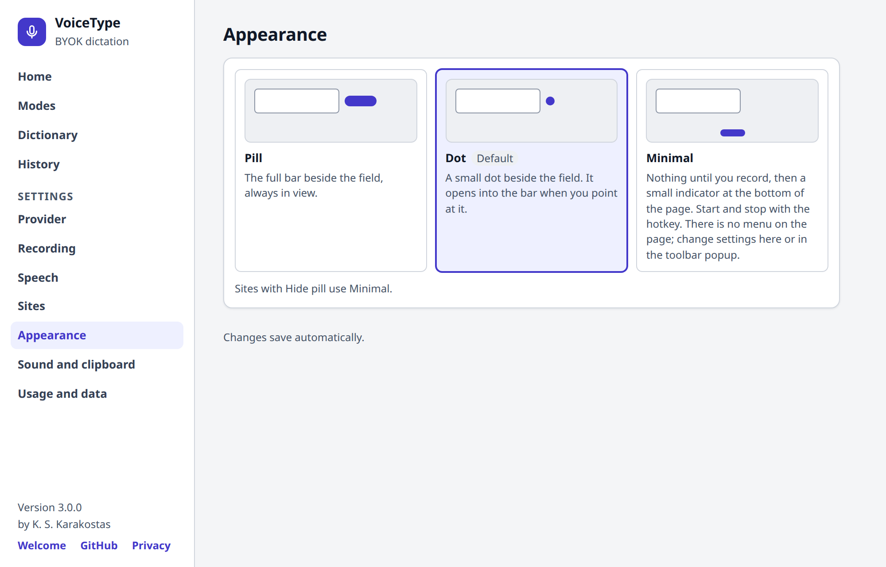

<p align="center">
  
</p>

<h1 align="center">VoiceType</h1>

<p align="center">
  <strong>BYOK dictation for Chrome with cost transparency</strong>
</p>

<p align="center">
  Transform your voice into text anywhere on the web.<br>
  Just speak. Let AI do the typing.
</p>

<p align="center">
  
  
  
</p>

---

<p align="center">
<picture>
  <source media="(prefers-color-scheme: dark)" srcset="screenshots/dark/in-use.png">
  
</picture>
</p>

<p align="center"><em>Compact, unobtrusive interface that appears next to any text field; the glow follows your voice</em></p>

---

## ✨ Features

<table>
<tr>
<td width="50%">

### 🎤 Voice to Text
Speak naturally into any text field on any website. VoiceType uses AI to accurately transcribe your speech with proper punctuation.

### 🤖 Multi-Provider Support  
Bring your own OpenAI or Gemini key. Speech recognition uses `gpt-transcribe` or `gemini-3.5-transcribe`; modes such as Email run the transcript through `gpt-6-luna` or `gemini-3.8-flash`.

### 📧 Smart Modes
Not just transcription: compose emails, translate languages, or ask AI questions directly with your voice.

### ✏️ Edit by Voice
Select text in a field, press the edit hotkey and say how to change it. The selection is replaced, as plain text.

</td>
<td width="50%">

### ⌨️ Hold to Talk
Hold the hotkey while you speak and let go to insert, or tap to start and tap again to stop. Works in iframes and fields in open shadow roots too.

### 📊 Home and Usage
See this week's time saved, words, speaking speed and cost per 1,000 words, plus sessions, audio time and estimated cost by period and provider.

### 📖 Dictionary
Keep names and jargon by language, up to 100 terms, with CSV import and export.

### 🌐 Site Rules
Hide the pill on a site, or give a site its own mode.

### 🕘 History
Your last 20 dictations stay in memory until you close the browser: insert or copy the last one, or undo a mode's edit. One switch turns it off.

### 🎨 Pill Styles
Dot (the default), Pill or Minimal, which comes in four sizes. Five recording colours. Optional sounds in four sets, and an option to also copy every result.

### 🔒 Privacy First
Keys stay in your browser's local extension storage, readable only by VoiceType's own extension pages, never synced. Audio goes straight to the provider you chose. No server of ours exists.

</td>
</tr>
</table>

---

## 📸 Screenshots

<table>
<tr>
<td align="center" colspan="2">
<picture>
  <source media="(prefers-color-scheme: dark)" srcset="screenshots/dark/settings-home.png">
  
</picture><br>
<strong>Home</strong><br>
<em>Time saved, words, speaking speed, days dictated and cost this week</em>
</td>
</tr>
<tr>
<td align="center" width="50%">
<picture>
  <source media="(prefers-color-scheme: dark)" srcset="screenshots/dark/quick-panel.png">
  
</picture><br>
<strong>Quick Panel</strong><br>
<em>Provider, active mode, this site's rule and today's cost</em>
</td>
<td align="center" width="50%">
<picture>
  <source media="(prefers-color-scheme: dark)" srcset="screenshots/dark/menu.png">
  
</picture><br>
<strong>Pill Menu</strong><br>
<em>Switch mode and provider, see today's cost and the hotkey</em>
</td>
</tr>
<tr>
<td align="center" width="50%">
<picture>
  <source media="(prefers-color-scheme: dark)" srcset="screenshots/dark/settings-dictionary.png">
  
</picture><br>
<strong>Dictionary</strong><br>
<em>Terms by language, with CSV import and export</em>
</td>
<td align="center" width="50%">
<picture>
  <source media="(prefers-color-scheme: dark)" srcset="screenshots/dark/settings-sites.png">
  
</picture><br>
<strong>Sites</strong><br>
<em>Hide the pill or set a mode, per site</em>
</td>
</tr>
<tr>
<td align="center" colspan="2">
<picture>
  <source media="(prefers-color-scheme: dark)" srcset="screenshots/dark/settings-appearance.png">
  
</picture><br>
<strong>Appearance</strong><br>
<em>Pill, Dot or Minimal, and the recording colour</em>
</td>
</tr>
</table>

---

## 🎯 Modes Explained

| Mode | Icon | What it does |
|------|:----:|--------------|
| **Default** | 🎤 | Transcription only as shipped: no text model, no extra cost |
| **Email** | 📧 | Transforms your ideas into formatted emails |
| **Translate** | 🌐 | Speak in any language, get text in another |
| **Instruct** | 💡 | Ask AI questions, get responses in the text field |

- A mode with instructions sends the transcript through the provider's text model (`gpt-6-luna` or `gemini-3.8-flash`), which adds a small text cost. Default ships with none; give it instructions and it does the same.
- Translate's target language (English, Greek, Spanish, French or German) is set under **Modes, Translate to**, or in the pill menu while Translate is the active mode.
- Add your own modes on the settings page under **Modes, Add mode**: an icon, a name and instructions for the text model. Empty instructions mean plain transcription. `{{targetLanguage}}` in the instructions is replaced with Translate's target language.

---

## 🚀 Quick Start

### 1. Install the Extension

```bash
# Clone the repository and build (requires Node.js 20.19+, 22.13+ or 24+)
git clone https://github.com/kskarakostas/VoiceType.git
cd VoiceType
npm install
npm run build
```

Or download the ZIP from GitHub, extract it (the folder is named `VoiceType-main`) and build there:

```bash
cd VoiceType-main
npm install
npm run build
```

Then in Chrome 140 or newer:
1. Go to `chrome://extensions/`
2. Enable **Developer mode** (top right)
3. Click **Load unpacked**
4. Select the `dist/` folder

### 2. Get an API Key

**Option A: OpenAI**
- Go to [platform.openai.com](https://platform.openai.com)
- Create an API key
- Cost: ~$0.0045/minute

**Option B: Google Gemini**
- Go to [aistudio.google.com](https://aistudio.google.com)
- Create an API key
- Cost: ~$0.006/minute; a free tier may be available

### 3. Configure & Go

1. A first install opens a **Welcome** page: it shows whether you have a key, the microphone and your hotkeys. Pin the VoiceType icon from the puzzle piece menu and click it, then **Add API key**. The settings page opens at **Provider**
2. Using Gemini? Select **Gemini** at the top of that page first. Paste your API key. It saves on its own
3. Open a web page (VoiceType does not run on Chrome's own pages or its extension pages) and click into a text field, then hold `Ctrl+Shift+Space` while you speak, or point at the dot beside the field and click **REC**
4. The first time, unless you already used **Allow microphone** on the Welcome page, VoiceType opens a tab asking for the microphone. Choose **Allow while visiting the site**, then start again

---

## ⌨️ Hotkey

`Ctrl+Shift+Space` by default (the Control key on a Mac too).

- **Hold** it while you speak and let go: the text is inserted.
- **Tap** it to start recording and tap again to stop.
- Pressed while the text is still being processed, the pill says "Still processing".

To change it, open the settings page, click the key under **Settings, Recording, Hotkey** and press the new combination. It needs Ctrl, Alt or Cmd plus a key; Esc cancels. Chrome keeps some shortcuts for itself (such as `Ctrl+T` or `Ctrl+W`) and never passes them to a page, so pick something else.

On Windows, do not choose a combination with both Ctrl and Alt: AltGr reports as Ctrl+Alt, so typing characters such as `@` or `€` would trigger it.

The hotkey works on web pages once they have loaded. Extensions cannot run on `chrome://` pages, the Chrome Web Store or the new tab page, and VoiceType does not run on its own settings page, so it does nothing there.

Only real key presses count. A web page cannot trigger the hotkey with synthetic key events from its own scripts.

---

## ✏️ Edit by Voice

Select text in a field, press `Ctrl+Shift+E` (the Control key on a Mac too) and say how to change it, such as "make this shorter" or "translate this into Greek". What you said is the instruction: it is never inserted. The selection is replaced with the result.

- **Hold** the hotkey while you speak and let go, or **tap** it to start and tap again to stop. The pill says "Say how to change the selection."
- In text boxes, one `Ctrl+Z` brings back the text you selected.
- The selected text goes to the text model of the provider you chose (`gpt-6-luna` or `gemini-3.8-flash`), with your instruction. It goes only after a press of this hotkey, only from the focused field, and never to the speech model. See What Is Sent below.
- An edit adds a small text cost. The active mode and a site's mode do not apply.
- Dictating over a selection has not changed: the dictation hotkey and **REC** put what you say in its place, and the selected text is sent nowhere.
- Change the hotkey under **Settings, Recording, Edit hotkey**, by the same rules as the dictation hotkey. It cannot be the same chord: the page says "Same as the dictation hotkey."

**Limits**
- A selection inside the focused field only. Text selected elsewhere on the page cannot be edited.
- Plain text: the selection's formatting is not kept.
- 10,000 characters at most. Past that the pill says "Selection too long to edit (10,000 characters at most)."
- With nothing selected the key press goes through to the page. In a field the pill also says "Select the text to edit first." Input types with no selection support (such as email) and Google Docs read as nothing selected.
- Password fields VoiceType can recognize are refused.
- While VoiceType records or processes, or a result is waiting for you, this hotkey does what the dictation hotkey does then.

**When an edit cannot land**
- The result goes in only if the field still has focus and the same text is still selected at the same place. Anything else copies it, and the pill says so: "Selection changed. Result copied to clipboard.", or "Copied to clipboard. The field could not be edited." if the page moves the selection while the result goes in, or the field does not take it. VoiceType never searches for the text.
- If you are in another window or tab when the result arrives, it waits as dictated text does ("Return to the field to insert, or click here to copy."), and gets the same check when you come back.
- In rich editors, a replacement VoiceType cannot confirm is also on the clipboard, and the pill says so.
- "No speech detected." changes nothing in the field.
- If the text model fails, returns nothing, is cut short or cannot make out a change to apply, as when speech recognition garbled your instruction, the field does not change and the pill says "Could not edit the selection. Click here to copy what you said." The click copies your instruction; the next press records, so you can try the same edit again at once. Speech recognition was paid for, so usage counts it. A failed edit adds no entry to History, and with the tab gone your instruction is not copied.

---

## 🎙️ Microphone

VoiceType records in its own extension page, not in the website you are typing on. The website never gets your microphone, and one permission covers every site, including sites whose policy blocks the microphone.

The first recording opens a VoiceType tab that asks for the microphone, unless you already used **Allow microphone** on the Welcome page. Choose **Allow while visiting the site**. "Allow this time" can expire as soon as that tab closes, and then VoiceType has to ask again.

While VoiceType records, Chrome shows its microphone indicator in the system tray or menu bar; the website's tab shows none. The microphone is released after every recording.

Blocked it by mistake? Open `chrome://settings/content/microphone`, find VoiceType under "Not allowed to use your microphone", set it to Allow, and start again.

---

## 📍 Where the Text Goes

- Into the field that had focus when you started recording, at the caret.
- If you clicked somewhere else before the text arrived, or the field disappeared, the text is copied to the clipboard and the pill says so. It never lands in a different field.
- If the text arrives while you are in another window or tab, or after you dictated into a field inside an embedded frame (an iframe) and then clicked into the page, it waits until you come back to that field and is inserted then. Until then the pill says "Return to the field to insert, or click here to copy." If you dictated into a field on the page and then clicked into a field inside an embedded frame, the text is copied to the clipboard instead.
- With no field focused (hotkey only), the text is copied to the clipboard.
- If the tab closed, or left for any other page, VoiceType's own included, before the text arrived, the text is copied to the clipboard, with no status on the new page. If Chrome restores the page when you go back, the text lands as usual if it has not arrived yet; if it has, the pill says "VoiceType restarted. Check the clipboard, or try again."
- Google Docs does not accept inserted text; VoiceType copies it and you paste with `Ctrl+V` (`Cmd+V` on a Mac).
- In rich editors (Gmail, Notion, Slack, ChatGPT, Facebook, claude.ai and others), if VoiceType cannot confirm the insert, the text is also on the clipboard. It is never inserted twice.
- In text boxes, one `Ctrl+Z` removes exactly the dictated text.
- Fields inside iframes and open shadow roots work too. VoiceType does not record in password fields, and input types such as number or date get no pill.
- With **Always copy the result** on, every dictation also goes to the clipboard, replacing what is there. If that copy fails, the status says "Not copied." and the text still goes to the field.
- If VoiceType's service worker stops while a dictation is processing, the page asks for it and VoiceType runs the same recording again, once, within two minutes of the recording's end. That is a second provider charge. The text lands as usual, and the dictation adds no entry to History. If that cannot happen, the pill says "VoiceType restarted. Check the clipboard, or try again."

---

## ⚙️ Settings and Quick Panel

Click the VoiceType icon for the quick panel: status, provider, active mode, **This site** (Hide pill and Mode on this site), today's sessions and cost, **Copy last** (hidden with Keep recent dictations off) and **Open settings**.

The settings page opens in a tab, also from **Extension options** on `chrome://extensions`. **Home**, **Modes**, **Dictionary** and **History** come first, then Settings: **Provider**, **Recording**, **Speech**, **Sites**, **Appearance**, **Sound and clipboard**, **Usage and data**.

- **Recording**
  - **Minimum length** (0.5, 1, 2 or 3 s; default 1 s): shorter recordings are discarded as accidental clicks, and the pill says "Too short, ignored".
  - **Maximum length** (30 s to 5 min; default 2 min): recording stops at this length, the pill says "Max time reached", and what you said is transcribed.
  - **Silence auto-stop** (Off, 2, 3 or 5 s; default Off): once you have spoken, recording stops after this much silence.
  - **Edit hotkey** (default `Ctrl+Shift+E`): see Edit by Voice above. If it matches the dictation hotkey, as it does if you had moved dictation to `Ctrl+Shift+E`, dictation wins, it does nothing and this page says so until you change one of them. **Reset to defaults** resets it.
- **Sites**: **Hide pill** removes the idle pill on a site; the hotkey still records there, with a small indicator at the bottom of the page. That indicator is always Small, whatever Minimal size you chose, and takes the recording colour. **Mode** gives a site its own mode. The rule goes by hostname, without `www.`; subdomains need their own rule. On a site with a mode, a mode picked in the pill menu updates that site; **Use active mode** clears it.
- **History**: your last 20 dictations with time, site and mode. A dictation in a frame from another site shows **This device** instead of a site. **Copy** takes the text, **Copy original** the transcript from before a mode changed it. An edit shows **Edit selection** as its mode: **Copy** takes the result and **Copy instruction** what you said. The selected text is not kept, though a result can repeat most of it. **Keep recent dictations** is on by default; turning it off clears them. A dictation in an incognito tab is not kept.
- **Appearance**
  - **Dot** (default): a small dot beside the field that opens into the bar when you point at it.
  - **Pill**: the full bar beside the field, always in view.
  - **Minimal**: nothing until you record, then an indicator beside the field (left of it if there is room, else right, above or below), or at the bottom of the page when the field has no room around it, is out of view, or no field has focus. A click goes through it. Start and stop with the hotkey. There is no menu on the page.
  - **Minimal size** (Small, Medium, Large or Extra large; default Medium): the indicator's size and its number of level bars, 4, 6, 8 or 10. It shows while Minimal is the style.
  - **Recording colour** (Classic red, Vampire red, Obsidian purple, Emerald green or Mocha brown; default Classic red): while you record, Pill and Dot (which opens into its bar) show it on the REC button and in the glow that follows your voice, and Minimal shows it on its level bars and has no glow. An error stays red and a success stays green whatever you choose.
- **Sound and clipboard**: **Play sounds** gives short tones for start, stop, done and error. **Sound set** (Soft, Warm, Single tap or Classic; default Soft) picks the tones: **Play** beside a set plays its four tones in turn, even with Play sounds off. **Always copy the result** also copies every dictation. Play sounds and Always copy are both off by default.
- Every change saves on its own; there is no Save button. A new mode is saved with **Create mode**, a new site rule with **Add**.
- **Clear** on History, **Clear usage history** and **Reset to defaults** need two separate clicks: the first changes the button's label, the second confirms. A double click or a held Enter does not confirm them.
- **Reset to defaults** keeps your API keys, provider, spoken languages, dictionary, site rules and the history choice. Custom modes are deleted, so a site rule that uses one loses its mode.

If the frame you dictate in is out of sight, hidden or covered, VoiceType shows the small indicator at the bottom of the page, in every style. It is always Small and takes the recording colour. It also stays on top of modal dialogs, popovers and fullscreen elements. Under a modal dialog it can be seen but not clicked: use the hotkey, or close the dialog to click a "click here to copy" status.

---

## 🕘 Last Dictation

Open the pill menu on a site where you dictated: **Last dictation** offers **Insert**, **Copy** and, when a mode changed the text, **Undo AI edit**. Minimal and a site with Hide pill have no menu; use **Copy last** in the quick panel, which copies your newest dictation from any site.

- **Insert** goes to the field focused when you click. With no field, or in a password field, the text goes to the clipboard.
- **Undo AI edit** puts the original transcript back in a text field or text box when the inserted text is still exactly where it landed; one `Ctrl+Z` brings the edit back. Anything else, a rich editor included, copies the original and says so.
- An edit offers **Insert** and **Copy** for its result, and no **Undo AI edit**. `Ctrl+Z` is its undo in text boxes and in the five editors tested (Lexical, Slate, ProseMirror, Quill, Tiptap); other editors have their own undo.
- The menu only offers what was dictated on this site. A frame from another site on the page gets nothing.

---

## 🗣️ Spoken Languages and Dictionary

Spoken languages live under **Settings, Speech**, the dictionary on its own page. Both are sent with every recording, whatever the mode.

**Spoken languages**
- **Auto** (default): the provider detects the language on its own.
- Tick one or more languages to steer recognition. They are hints about what to expect, not a lock.
- Mixing languages, such as Greek with English terms? Tick every language you mix; that is what the list is for. With only one ticked, words from the other language are more likely to come out wrong.

**Dictionary**
- Product names, people's names, jargon, acronyms. Write each exactly as it should appear, such as `Noesis`. Enter adds a term; commas split.
- Groups by language only organize your terms: every term of every group goes with every dictation.
- Up to 100 terms of up to 64 characters each, and each term only once.
- **Export CSV** writes `language,term` rows. A term starting with `=`, `+`, `-` or `@` gets a leading `'`, so a spreadsheet reads it as text; import removes it. **Import CSV** takes that format or a one-column list, merges into your groups and skips terms you already have. A file with an error, or one that would pass 100 terms, imports nothing.
- A term makes the provider more likely to hear it, not certain to. A name that sounds like a common word (Noesis and "noises") is recognized more often but can still slip.

---

## ❓ FAQ

<details>
<summary><b>Is VoiceType free?</b></summary>
<br>
The extension is free. You need an API key from OpenAI (pay-per-use) or Google Gemini (may offer a free tier; check aistudio.google.com).
</details>

<details>
<summary><b>Which provider should I use?</b></summary>
<br>
Both are accurate for dictation. Gemini's transcribe model removes filler words on its own. OpenAI is the default. Costs are comparable; see the Pricing Estimate below.
</details>

<details>
<summary><b>Why doesn't the hotkey work?</b></summary>
<br>
VoiceType listens for the hotkey inside web pages, so click into the page first. It cannot work on <code>chrome://</code> pages, the Chrome Web Store or the new tab page. Chrome keeps some shortcuts such as <code>Ctrl+T</code> for itself; pick another combination under Settings, Recording, Hotkey.
</details>

<details>
<summary><b>Why did my text go to the clipboard?</b></summary>
<br>
The field you started in lost focus or disappeared before the text arrived, no field was focused, the selection you were editing changed, or the site (Google Docs) does not accept inserted text. VoiceType never types into a different field. Paste with <code>Ctrl+V</code>.
</details>

<details>
<summary><b>Why are short recordings ignored?</b></summary>
<br>
Recordings shorter than the minimum you set (default 1 second) are treated as accidental clicks. Change it under Settings, Recording, Minimum length.
</details>

<details>
<summary><b>Does it work offline?</b></summary>
<br>
No. Audio must be sent to OpenAI or Google for AI processing.
</details>

---

## 🔧 Troubleshooting

| Problem | Solution |
|---------|----------|
| **"Could not load javascript 'content.js'" or "Could not load manifest"** | You selected the repository folder. Run `npm run build`, then choose the `dist/` folder in **Load unpacked** |
| **"Add an API key" message** | Click the extension icon, then **Add API key**, and paste your key on the settings page |
| **Microphone not working** | VoiceType asks in its own tab, not in the site's address bar. If the pill says the microphone is blocked, open `chrome://settings/content/microphone`, find VoiceType under "Not allowed to use your microphone", set it to Allow, and start again |
| **Asked for the microphone every time** | You chose "Allow this time". Reset it at `chrome://settings/content/microphone`, start a recording and choose **Allow while visiting the site** |
| **Hotkey doesn't work** | Click into the page first. Browser shortcuts such as `Ctrl+T` never reach a page; set another hotkey under Settings, Recording, Hotkey |
| **"VoiceType was turned off or updated. Reload this page."** | VoiceType was turned off on `chrome://extensions`, or that tab could not be switched to the new version. Turn VoiceType on if it is off, then reload the page |
| **"VoiceType restarted. Check the clipboard, or try again."** | VoiceType's service worker stopped during processing and the dictation could not be run again, or you came back to a page whose text was already copied. Check the clipboard, then dictate again |
| **Text went to the clipboard** | Focus moved before the text arrived, or the site does not accept inserted text. Paste with `Ctrl+V` |
| **Transcription fails** | Check your API key and account balance |
| **VoiceType is off after an update** | A store install stays off until you accept the new permission: open the Chrome menu, click the VoiceType line, then **Accept permissions**. Loading the new build unpacked asks nothing |
| **Names or jargon come out wrong** | Add them on the Dictionary page, spelled as they should appear |
| **Mixed-language speech comes out garbled** | Tick every language you speak under Settings, Speech, Spoken languages |
| **Poor quality** | Speak clearly, reduce background noise, or try the other provider |

---

## 💰 Pricing Estimate

| Provider | Model | Cost |
|----------|-------|------|
| OpenAI | gpt-transcribe | ~$0.0045 per minute |
| OpenAI | gpt-6-luna (modes, edits) | $0.10 in / $0.50 out per 1M tokens |
| Gemini | gemini-3.5-transcribe | ~$0.006 per minute |
| Gemini | gemini-3.8-flash (modes, edits) | $0.75 in / $3.75 out per 1M tokens (list price through 2026) |

*A typical 30-second recording costs less than $0.01*

---

## 📤 What Is Sent

| Mode | To the speech model | To the text model |
|------|---------------------|-------------------|
| No instructions (Default as shipped) | Audio, spoken languages, dictionary terms | Nothing |
| With instructions | Audio, spoken languages, dictionary terms | The transcript text and the mode's instructions, never the audio |
| Edit hotkey | Audio, spoken languages, dictionary terms | The transcript of your instruction, the selected text and VoiceType's fixed edit instructions, never the audio |

- Everything goes straight from your browser to the provider you chose, with your key. Both steps use that same provider.
- Selected text goes only to the text model, only with the edit hotkey. The dictation hotkey never sends it.
- While a dictation is processing, its audio and an edit's selected text are held in Chrome's session storage, in memory. If the service worker stops and the page is still open, they are sent again, once, within two minutes of the recording's end: that is a second provider charge.
- On Gemini, speech recognition already removes filler words and self-corrections and formats the text, even in Default. On OpenAI, Default returns the transcript as recognized.

---

## 🔒 Privacy

- ✅ API keys stored in plain text in Chrome's local extension storage, readable only by VoiceType's own service worker and extension pages, never synced, never sent anywhere but the provider
- ✅ Web pages never receive your keys or your microphone; audio is recorded in VoiceType's own extension page
- ✅ Audio sent directly to OpenAI/Google (not our servers)
- ✅ Selected text leaves the device only after a press of the edit hotkey, only from the focused field and only to the chosen provider's text model. It is not kept; the result and your instruction sit in recent dictations, and a result can repeat most of it
- ✅ Audio and an edit's selected text are held in Chrome's session storage, in memory, while a dictation is processing, so a stopped service worker can retry once, a second provider charge. If a stopped worker leaves them behind, they go when the tab closes or the next time the worker runs after two minutes, at the latest at browser close
- ✅ Site rules and your dictionary stay on this device; dictionary terms go to the provider with each recording
- ✅ The `clipboardWrite` permission lets VoiceType copy results with no click, for **Always copy the result** and for text it cannot insert, or when the page does not take the result within 5 seconds. It never reads the clipboard
- ✅ Recent dictations stay in memory, not on disk, and go at browser close. A page's pill only gets the newest one dictated on that site
- ✅ No analytics or tracking
- ✅ Fully open source

---

## 🧪 Development

```bash
npm install
npm test            # unit tests (Vitest)
npm run build       # bundle into dist/
npm run watch       # rebuild on change
npm run test:e2e    # build, then the Playwright smoke in Chromium
npm run screenshots # build, then retake screenshots/light and screenshots/dark
npm run lint:ext    # web-ext lint on dist/; two Firefox-only errors are exempt
npm run package     # zip dist/ as voicetype-<version>.zip
```

The end-to-end smoke loads `dist/` into Playwright's Chromium with a fake microphone, stubs the provider endpoints and blocks every other https request, so it needs no API key. Install its browser once with `npx playwright install --no-shell chromium` (add `--with-deps` on a fresh Linux machine). `npm run screenshots` uses the same setup with `test/fixtures/demo.html`, a sample key and sample usage history.

---

## 📄 License

MIT License: use it, modify it, share it.

---

## 👨‍💻 Author

**K. S. Karakostas**

---

<p align="center">
  <strong>⭐ Star this repo if you find it useful!</strong>
</p>

<p align="center">
  <a href="https://github.com/kskarakostas/VoiceType/issues">Report Bug</a>
  ·
  <a href="https://github.com/kskarakostas/VoiceType/issues">Request Feature</a>
</p>
